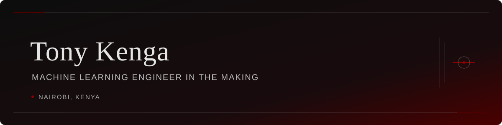

<p align="center">
  
</p>

<p align="center">
  <a href="mailto:tonykenga23@gmail.com">Email</a> &nbsp;·&nbsp;
  <a href="https://www.linkedin.com/in/tony-kitili-b7203040b/">LinkedIn</a> &nbsp;·&nbsp;
  <a href="https://www.kaggle.com/kitilikenga">Kaggle</a> &nbsp;·&nbsp;
  <a href="https://orcid.org/0009-0007-6899-8590">ORCID</a>
</p>

<p align="center"><sub>FINAL-YEAR BSc DATA SCIENCE &nbsp;·&nbsp; NAIROBI, KENYA &nbsp;·&nbsp; MACHINE LEARNING ENGINEER IN THE MAKING</sub></p>


## Building towards intelligent systems.

I'm Tony Kenga, a final-year Data Science student based in Nairobi, Kenya, developing practical expertise in machine learning, predictive modelling and data-driven engineering.

> My focus is on taking analytical ideas beyond experimentation and turning them into reproducible, useful applications.

<sub>CURRENT FOCUS</sub>

```text
NOW        TechPulse — final-year research project
NEXT       Machine Learning Engineering internship
COMMUNITY  Skynet DataGrid Labs
```

## Selected work

### [TechPulse](https://github.com/Tony405-spec/TechPulse)

An ML platform that predicts a developer's technology trajectory from skill and activity signals.

<sub>`Python` · `scikit-learn` · `Predictive modelling`</sub>

### [Customer Churn Prediction](https://github.com/Tony405-spec/customer-churn-prediction)

An end-to-end churn pipeline spanning data, training and evaluation, built and run entirely on GitHub Actions without local execution.

<sub>`Python` · `scikit-learn` · `GitHub Actions` · `CI/CD`</sub>

### [Dockerized CIFAR-10 Classifier](https://github.com/Tony405-spec/docker-ml-portfolio)

TensorFlow image classification in a reproducible Docker training environment, with an optimized image and containerized file management.

<sub>`TensorFlow` · `Docker` · `Computer vision`</sub>

### [Tableau Dashboard Templates](https://sites.google.com/view/kengadashboardtemplates)

An independent product line of production-ready dashboards, including builds on Kenyan datasets covering 47 counties and FMCG sales, sold through Selar and a Google Sites storefront.

<sub>`Tableau` · `Data visualization` · `Analytics`</sub>

### [Web Scraping with R](https://github.com/Tony405-spec/Web-Scraping-with-R)

Web scraping with `rvest`, paired with an interactive 3D terrain visualization in Plotly.

<sub>`R` · `rvest` · `Plotly`</sub>

<p align="center"><sub>Also building with <a href="https://github.com/skynet-datagrid-labs">Skynet DataGrid Labs</a></sub></p>

## Toolkit

<sub>DAILY USE</sub><br />
Python · pandas · NumPy · scikit-learn · TensorFlow · SQL (PostgreSQL) · Git · GitHub Actions · Tableau · Plotly

<sub>WORKING KNOWLEDGE</sub><br />
Docker · PyTorch · Keras · R · Power BI

<sub>LEARNING NEXT</sub><br />
MLflow · Kubernetes

## Selected achievement

### [House Prices: Advanced Regression Techniques](https://www.kaggle.com/competitions/house-prices-advanced-regression-techniques/leaderboard)

**Second place on the public leaderboard** · RMSLE **0.00044**

<sub>METHOD</sub><br />
Lasso (0.60) and XGBoost (0.40), with 77 selected features. The ensemble used five random seeds.

<sub>VALIDATION</sub><br />
Price-stratified five-fold cross-validation, out-of-fold RMSE **0.1082**.

## Development footprint

<sub>Repository activity and language mix</sub>

<p align="center">
  
</p>

<p align="center">
  
</p>

<p align="center"><sub>CV link pending</sub></p>


